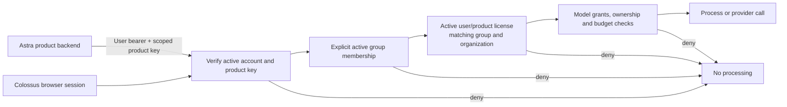

# Product authorization at the Colossus boundary

Each licensed **user/product** pair is separate from group membership and credits. Product licenses are not billing balances. Colossus operators manage licenses in **API access → Product licenses**. Every license has an explicit start and expiry, group binding, organization binding, status and audit actor. No initial licenses are auto-issued.

## Request admission when enforcement is active

- Product identity comes from the server-verified scoped system key. A Colossus browser session is attributed to `colossus`; body fields and arbitrary product headers are never authoritative.
- Every protected `/v1/` request below the management routes, and private Christopher HTML/assets, passes the product gate before reading sources or admitting computation. Active account state, key expiry/revocation, membership, license and tenant binding are read for each request. No positive entitlement cache is kept.
- Legacy shared/provider keys, bare user JWTs without an approved product key, and product keys without an end-user identity cannot process requests under enforcement.
- Allowed products are `colossus`, `workflow`, `enigma`, `lab`, `evidence`, `observer`. Registering an arbitrary external system does not make it an approved product.
- An implicit free-PDF group is insufficient. Group members must be explicitly assigned in both the membership index and the group's member list. Moving groups or organizations requires a matching new license grant.
- Global administrator status alone does not grant processing access. Christopher additionally requires the global administrator role and an explicit `christopher` model grant.
- A scoped product key authenticates the calling backend; it is not itself a user's license. Keep it server-side. Anyone holding valid stolen credentials could impersonate that caller; visible API URLs and CORS cannot prevent that. Existing expiry/revocation controls remain necessary.
- Revocations stop newly admitted requests; requests admitted earlier may finish. Connection checks, account provisioning, monitoring and license management remain operator functions. Their existing verified-administrator and same-origin protections remain in place so an operator can repair access.

## Rollout and current activation state

A missing policy record means **setup mode**, preserving the existing deployed access checks while explicit licenses are prepared. It does **not** mean separate product-license enforcement is active. A malformed policy or failed read denies access. The policy is stored at `accessPolicies/products` in the existing operations database; it must remain private to the runtime and deployment operators.

1. Confirm the approved initial accounts, product list, groups and license dates. Do not derive licenses from email domain, administrator status, free credits or group membership.
2. Ensure product backends send both the user's verified bearer token and their existing scoped product key. Service-only clients will need a separately approved service-identity policy before they can be admitted; this change introduces no service-only bypass.
3. Grant only those explicit user/product licenses. Include the operator's Colossus license and a group with the necessary model grants. Inspect assignments before activation.
4. Activate from the API-access panel or `POST /v1/control/product-access` with `{ "enabled": true }`. The server first checks the operator's own Colossus membership and license. The endpoint cannot disable enforcement.
5. Verify an approved call and denials for missing license, another product, revoked membership, expired/revoked credentials and cross-tenant changes before announcing enforcement.

No production activation or license grant is part of this code change. Initial license assignments are awaiting the owner's account/product decision. Once activation is performed, operator management remains available even if a product license expires. Disabling an enforced policy is deliberately not a normal API/UI operation; any recovery intervention must preserve explicit operator authorization and an audit trail.

## Management contract

Global administrator account cookie + same-origin writes only:

- `GET /v1/control/product-access`: policy state, approved product IDs and license records.
- `POST /v1/control/product-licenses`: `userId`, `productId`, `groupId`, `status` (`active`, `suspended`, `revoked`), ISO `startsAt`, ISO `expiresAt`, and `expectedUpdatedAt` (`null` on creation). Organization binding is resolved from authoritative membership, never accepted from a caller. A stale update is rejected.
- `POST /v1/control/product-access`: `{ "enabled": true }`. Operator Colossus license required before activation.

Revocation can be recorded while a license holder's organization or product is paused. All changes are audited before the conditional write. Failed write attempts remain auditable; an audit entry alone is not proof that the write succeeded.

## Boundary of this change

This protects **Colossus APIs and the processing routed through Colossus**. It does not add a license guard to APIs hosted directly by Workspace, Lab, Enigma, Evidence or Observer. Those products must enforce their own resource ownership and the same product entitlement before claiming coverage of all product APIs. Existing source ownership checks are retained; a Colossus license does not grant access to another user's documents.

See [OWASP Authorization Cheat Sheet](https://cheatsheetseries.owasp.org/cheatsheets/Authorization_Cheat_Sheet.html) for deny-by-default authorization and per-request checks. The deliberate setup phase is a migration state, not a claim that those stronger rules are already enforced in production.
